# Roteiro do Vídeo de Pitch & Demonstração — Sprint 4
**Projeto:** Motiva VerdeCheck Mobile  
**Challenge:** FIAP + CCR Motiva  
**Tempo Total Alvo:** Entre 3m45s e 4m45s (Limite máximo do edital: 5 minutos)  
**Formato de Entrega:** Vídeo no YouTube como "Não Listado" (*Unlisted*)

---

## 👥 Integrantes e RMs
* Matheus Morelli — RM: 562765
* Rafael Ferreira — RM: 563285
* Cauã Muniz — RM: 566527
* Henrique Mortari — RM: 564699
* Victor Mortari — RM: 564804
* Lucas Eiki — RM: 561607

---

## 🎬 Visão Geral e Estrutura dos 5 Minutos

```mermaid
gantt
    title Cronograma do Vídeo (Máx 5 minutos)
    dateFormat  ss
    axisFormat  %S s
    section 1. Introdução & Problema
    Apresentação & Dor CCR         :00, 45s
    section 2. Demonstração App
    Login & Dashboard             :45, 35s
    Cenário Cortar (Crítico)      :80, 50s
    Cenário Conforme & Histórico  :130, 45s
    section 3. Negócio & Impacto
    Plano de Negócio & Custos     :175, 55s
    ROI & Evolução Sprints        :230, 35s
```

---

## 📋 Roteiro Detalhado: Fala a Fala e O que Mostrar na Tela

---

### BLOCO 1: Apresentação do Grupo e o Problema CCR Motiva (0:00 - 0:45)
* **Objetivo:** Estabelecer credibilidade, apresentar o grupo e contextualizar a dor operacional da CCR.
* **O que mostrar:** Câmera aberta nos integrantes (ou gravação com webcam no canto) e slide/tela inicial do app com o logo do VerdeCheck.

> **[Integrante 1 - Apresentação]:**  
> *"Olá a todos e à banca avaliadora! Somos a equipe responsável pelo **Motiva VerdeCheck Mobile**, desenvolvido no Challenge FIAP em parceria com a CCR Motiva. O grupo é composto por Matheus Morelli, Rafael Ferreira, Cauã Muniz, Henrique Mortari, Victor Mortari e Lucas Eiki.*  
> 
> *Hoje, a manutenção da vegetação na faixa de domínio de rodovias concedidas é um dos maiores desafios operacionais da CCR. Tradicionalmente, a decisão de mobilizar equipes e tratores para roçada depende do 'olhômetro' do fiscal ou de calendários fixos que ignoram a taxa real de crescimento da grama.*  
> 
> *O resultado disso? Duas pontas críticas: ou se gasta combustível e maquinário cortando grama que ainda não precisava, ou a vegetação cresce demais, encobrindo placas e canaletas, o que gera autuações pesadas de órgãos como ARTESP e ANTT, além de graves riscos de incêndios e atropelamento de animais."*

---

### BLOCO 2: Demonstração Prática do Aplicativo no Aparelho (0:45 - 2:55)
* **Objetivo:** Mostrar o app instalado e rodando fluidamente no Android, cobrindo os fluxos avaliativos da Sprint 3 e 4.
* **O que mostrar:** Gravação da tela do smartphone (ou aparelho físico em mãos) com toques visíveis.

#### 2.1 Login e Dashboard (0:45 - 1:20)
* **O que fazer na tela:**
  1. Abrir o aplicativo a partir do ícone no Android.
  2. Na tela de Login, destacar o design institucional CCR e tocar no botão **"Acesso Rápido Demo (Lucas Almeida)"**.
  3. A aplicação carrega instantaneamente a Home.

> **[Integrante 2 - Demonstração]:**  
> *"Para resolver esse problema, criamos o Motiva VerdeCheck. Aqui está o aplicativo instalado no dispositivo Android.  
> O operador inicia na tela de autenticação institucional com persistência de sessão. Para nossa demonstração, temos o atalho rápido do nosso operador modelo, o Lucas Almeida.  
> Ao entrar, somos recepcionados pelo Dashboard Operacional: ele exibe o status de conexão, as métricas em tempo real de vistorias do dia, trechos críticos e conformes, e um card com o padrão normativo da CCR."*

#### 2.2 Fluxo 1: Nova Análise — Cenário Crítico ("Cortar") (1:20 - 2:10)
* **O que fazer na tela:**
  1. Tocar no botão **"Nova Análise"** (no centro da barra inferior ou no botão de ação da Home).
  2. Preencher os campos: Rodovia **SP-310**, KM **142**, Sentido **Norte (Interior)**.
  3. No seletor visual de segmento, escolher **"Canteiro Central"** (o app indica a norma de 20 cm).
  4. Digitar altura estimada de **120** cm.
  5. Tocar em **"Avançar para Captura"**.
  6. Na tela de câmera, selecionar a foto de mato alto (via câmera ou preset).
  7. Confirmar a análise: a tela de processamento exibe o spinner e o checklist de inferência.
  8. Na tela de Resultado, destacar o **card vermelho**, status **"Cortar"**, severidade **"Crítico"** e cálculo do excesso (+100 cm acima da norma).
  9. Tocar em **"Salvar no Histórico"**.

> **[Integrante 2 ou 3 - Demonstração]:**  
> *"Vamos simular uma vistoria de pista. O operador informa a rodovia — por exemplo, SP-310 —, o quilômetro 142 e o sentido Norte.  
> Ele seleciona o segmento viário específico. Observem que o app já carrega as tolerâncias oficiais da concessionária: para Canteiro Central, o limite é de 20 centímetros.  
> Ao registrar uma altura de 120 centímetros e capturar a evidência fotográfica, o sistema processa a imagem em menos de 2 segundos.  
> O resultado é imediato e indiscutível: diagnóstico em card vermelho com a recomendação **'Cortar'**, severidade **Crítica**, apontando exatamente que a vegetação está 100 cm acima do tolerado. O laudo é carimbado e gravado no histórico."*

#### 2.3 Fluxo 2: Cenário Conforme ("Não Cortar") e Histórico Auditável (2:10 - 2:55)
* **O que fazer na tela:**
  1. Voltar rapidamente em **"Nova Análise"**, preencher Rodovia **SP-348**, KM **45**, selecionar **"Faixa de Domínio"** (limite de 30 cm) e altura de **18** cm.
  2. Capturar a foto de grama rasteira e processar.
  3. Mostrar o card **verde esmeralda** com a decisão **"Não cortar"** (Em conformidade).
  4. Abrir a aba **"Histórico"**:
     * Mostrar os filtros rápidos (*Todos*, *Cortar*, *Conformes*).
     * Tocar em um card para abrir a tela de **Detalhes da Inspeção**.
     * Mostrar a foto auditada, a data, a precisão e o botão **"Encaminhar para Supervisão"**.
     * Mencionar que todo o sistema funciona **Offline-First**.

> **[Integrante 3 - Demonstração]:**  
> *"Em contrapartida, se inspecionarmos a SP-348, num trecho de Faixa de Domínio onde a grama está com 18 centímetros — bem abaixo do limite de 30 cm —, o VerdeCheck emite na hora o veredito verde: **'Não cortar'**. Isso evita imediatamente a mobilização indevida de tratores, economizando combustível e hora-máquina.  
> Na aba de Histórico, a supervisão tem acesso a todos os laudos, com filtros rápidos por criticidade e visualização profunda de cada vistoria, incluindo a foto real carimbada com data e métricas.  
> E o mais importante: todo esse fluxo opera de forma **100% Offline-First**, garantindo que o fiscal trabalhe perfeitamente mesmo nos trechos de serra e áreas remotas sem sinal 4G."*

---

### BLOCO 3: Plano de Negócio e Viabilidade Comercial (2:55 - 4:10)
* **Objetivo:** Demonstrar viabilidade comercial, mercado CCR, custos operacionais e modelo de receita B2B SaaS.
* **O que mostrar:** Slide corporativo limpo resumindo os números-chave ou a tela do documento de negócio.

> **[Integrante 4 - Negócio e Modelo de Receita]:**  
> *"Agora, falando da viabilidade e do nosso Plano de Negócio:  
> O Motiva VerdeCheck foi modelado como um **B2B SaaS especializado em infraestrutura rodoviária**.  
> Nosso modelo de precificação é baseado na extensão da malha concedida monitorada, com valores entre **R$ 14 e R$ 18 por quilômetro ao mês**, além de planos fechados para trechos piloto a partir de R$ 2.800 mensais.  
> Olhando apenas para o universo do Grupo CCR, que administra quase 4 mil quilômetros de rodovias — como AutoBAn, ViaOeste e SPVias —, temos um mercado potencial imediato de **R$ 650 mil a R$ 850 mil por ano**."*

> **[Integrante 5 - Custos e Impacto Financeiro (ROI)]:**  
> *"Do ponto de vista de custos operacionais (OPEX), nossa arquitetura em nuvem é extremamente enxuta. Projetamos um custo mensal de apenas **R$ 7.180,00**, englobando servidores em nuvem, armazenamento frio de evidências no S3, custos de inferência e manutenção continuada.  
> Isso gera uma margem operacional altamente atrativa. Mas o maior ganho está no bolso da concessionária:  
> Uma frente de roçada custa entre R$ 3.500 e R$ 6.000 por km. Ao erradicar cortes precoces e priorizar trechos críticos, geramos uma **redução comprovada de 15% a 22% nos gastos anuais de conservação** — o que significa mais de **R$ 250 mil economizados por ano** em uma concessão média de 300 km, além de blindar a CCR contra multas milionárias da ARTESP e ANTT."*

---

### BLOCO 4: Evolução das 4 Sprints e Fechamento (4:10 - 4:45)
* **Objetivo:** Evidenciar maturidade, evolução do projeto do início ao fim e encerramento seguro.
* **O que mostrar:** Tela do README com a tabela de evolução das Sprints ou câmera aberta nos integrantes.

> **[Integrante 6 - Evolução e Encerramento]:**  
> *"Chegamos à Sprint 4 com um produto robusto e validado, fruto de uma evolução consistente:  
> - Na **Sprint 1**, definimos a persona do Lucas, os requisitos e a arquitetura inicial;  
> - Na **Sprint 2**, estruturamos a navegação com rotas protegidas e persistência offline;  
> - Na **Sprint 3**, consolidamos o protótipo funcional completo e nossa bateria de testes manuais com zero erros críticos;  
> - E agora, na **Sprint 4**, entregamos o **build final em formato APK para Android**, testado e pronto para instalação em dispositivos reais, acompanhado do plano de negócio B2B e documentação completa no GitHub.  
> 
> O Motiva VerdeCheck transforma uma rotina analógica e custosa em uma operação guiada por dados, economia e sustentabilidade. Muito obrigado a todos!"*

---

## 💡 Dicas de Gravação para Nota Máxima

1. **Protagonismo Humano (Obrigatório pelo edital):** Não utilize geradores de voz por IA. A banca exige a voz e participação dos alunos do grupo.
2. **Tempo Limite:** Treine o roteiro com cronômetro. O ideal é que o vídeo fique entre **3 minutos e 45 segundos e 4 minutos e 30 segundos**. Não ultrapasse 5 minutos!
3. **Qualidade de Áudio e Imagem:** Grave em local silencioso. Ao gravar a tela do celular, utilize o gravador de tela nativo do Android ou transmita via *scrcpy* / emulador para capturar em resolução 1080p nítida.
4. **Configuração no YouTube:** Suba o vídeo como **"Não Listado"** (*Unlisted*). Não coloque como "Privado" (a banca não conseguiria abrir) nem como "Público" se não quiserem.
5. **Atualização do Link:** Assim que fizer o upload, copie a URL do YouTube e substitua em `entrega_sprint4.txt` e no `README.md`.
